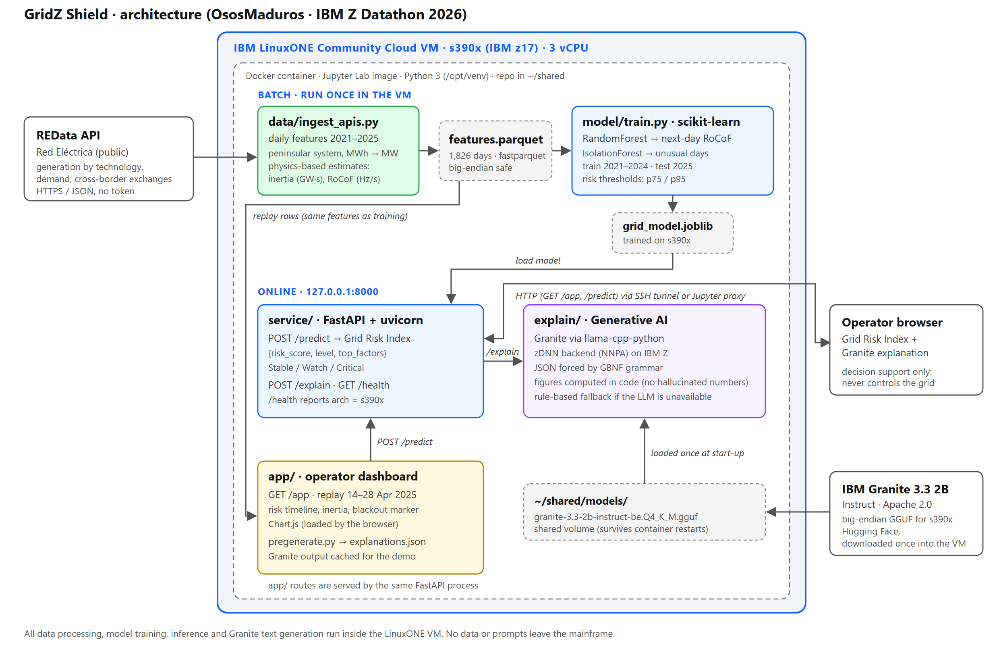

# Architecture and module contracts

These are the contracts between modules. Column names, JSON fields and endpoints below are what the code implements; change them only after agreeing with the team, and update this file in the same pull request.



## Data flow
```
REData API ──> data/ingest_apis.py ──> data/features.parquet ──> model/train.py ──> model/grid_model.joblib
                                              │                                              │
                                              └── app/replay.py ──> POST /predict (service/) <┘
                                                                          │
                                                   POST /explain (explain/, Granite) ──> app/ dashboard
```
Batch steps (ingestion, training, Granite pre-generation) run once inside the LinuxONE VM. The API (`service/`) serves `/predict`, `/explain`, `/health` and the dashboard (`/app`) from a single FastAPI process bound to `127.0.0.1:8000`.

## Modules
| Module | Folder | Input | Output |
|---|---|---|---|
| Data | `data/` | REData API (generation, demand, exchanges) | `data/features.parquet` (columns below) |
| Model | `model/` | `features.parquet` | `model/grid_model.joblib` (regressor, anomaly model, thresholds); metrics printed on screen |
| Inference service | `service/` | One row of features plus history (`/predict` input below) | Risk result JSON |
| Explanation | `explain/` | Risk result JSON plus the day's figures | Summary, 2 recommended actions, technical details |
| Dashboard | `app/` | Replay rows from `features.parquet` + the API | Operator view (`/app`) and pre-generated explanations |

## features.parquet (columns)
Source: REData (Red Eléctrica), peninsular system, daily resolution (MWh/day converted to average MW). Written with `fastparquet` and read back after writing to verify it on big-endian s390x.

| Column | Type | Unit / meaning |
|---|---|---|
| `timestamp` | string, ISO 8601 UTC (`YYYY-MM-DDTHH:MM:SSZ`) | Start of the day: local (peninsular) midnight expressed in UTC, so it shows 22:00 or 23:00 of the previous day |
| `demand_mw` | float | Average demand (REData `demanda/evolucion`) |
| `gen_total_mw` | float | Total generation (sum of technologies, excluding the API's own "Generación total" row) |
| `gen_nonsync_mw` | float | Wind + solar PV + solar thermal (team decision for the share) |
| `gen_sync_mw` | float | Nuclear, hydro, gas, coal, cogeneration, etc. |
| `nonsync_share` | float | `gen_nonsync_mw / gen_total_mw`, range 0–1 |
| `interconnection_balance_mw` | float | Scheduled net imports (+) / exports (−), all borders |
| `label_event` | int (0/1) | 1 only for a documented instability event (28 April 2025 blackout), 0 otherwise. Used for the retrospective case study and to exclude the distorted day from training; never a training target |
| `label_proxy` | int (0/1) | 1 if `nonsync_share > 0.55`. Descriptive only: it is a rule on an input column, so it is **not** used as a training target (it would leak the label) |
| `inertia_est_gws` | float | Estimated kinetic energy `Σ Hᵢ·Pᵢ` in GW·s. *H* per technology from OECD-NEA (2020); wind and PV 0 s, solar thermal 3 s (see `data/ingest_apis.py`) |
| `rocof_est_hz_s` | float | Estimated initial RoCoF for a 1,000 MW loss with the peninsular system isolated: `ΔP·f₀ / (2·E)` |

Measured frequency and RoCoF (`frequency_hz`, `rocof_hz_s`) were removed: no open source publishes them without a token. `inertia_est_gws` and `rocof_est_hz_s` are physical estimates, not measurements.

## Model (`model/train.py`)
- **Target:** next day's `rocof_est_hz_s` (regression).
- **Features:** the parquet columns above (except labels) plus `rocof_lag1`, `nonsync_share_lag1` (previous day), `rocof_roll7_mean`, `nonsync_roll7_mean` (7-day means), `day_of_week`, `month`.
- **Split:** train 2021–2024, test 2025 (by date, no shuffling). The split uses the UTC year of `timestamp`, so 1 January 2025 (local) falls in the training set; the test set is 2 January to 30 December 2025 (362 days). The blackout day (`label_event == 1`) is excluded.
- **Models:** `RandomForestRegressor` (forecast) and `IsolationForest` (unusual days).
- **Risk thresholds:** 75th and 95th percentiles of the training target, stored in the artifact.
- **Artifact** (`grid_model.joblib`, a dict): `regressor_model`, `anomaly_model`, `feature_names`, `anomaly_feature_names`, `percentile_75`, `percentile_95`, `train_rocof_distribution`.

## API (`service/main.py`)
### `POST /predict`
Input: one row of `features.parquet` plus the history columns, with the same names as in `model/train.py`. The service does not recompute or fill any feature; a missing field returns HTTP 422.
```json
{
  "timestamp": "2025-04-25T22:00:00Z",
  "demand_mw": 22854.5, "gen_total_mw": 27168.8, "gen_nonsync_mw": 15287.9, "gen_sync_mw": 11881.0,
  "nonsync_share": 0.5627, "interconnection_balance_mw": -3329.9,
  "inertia_est_gws": 57.14, "rocof_est_hz_s": 0.4375,
  "rocof_lag1": 0.3546, "nonsync_share_lag1": 0.4405, "rocof_roll7_mean": 0.3878, "nonsync_roll7_mean": 0.4688,
  "is_simulated": false
}
```
Output (risk result):
```json
{
  "timestamp": "2025-04-25T22:00:00Z",
  "risk_score": 0.86,
  "level": "Critical",
  "top_factors": ["inertia_est_gws", "interconnection_balance_mw"],
  "is_simulated": false
}
```
- `level` is `Stable` (predicted RoCoF below p75), `Watch` (p75–p95) or `Critical` (above p95).
- `risk_score` is in [0, 1]: Stable 0–0.50, Watch 0.50–0.85, Critical 0.85–1.
- `top_factors` lists up to two of `inertia_est_gws`, `nonsync_share` and `interconnection_balance_mw`, ordered by how far they are beyond their 2021–2024 reference (inertia below p25, share above p75, |exchange| above p75). It is empty on a `Stable` day with nothing unusual.

### `POST /explain`
Input: the risk result plus, optionally, the day's figures, so Granite does not need to infer numbers.
```json
{
  "timestamp": "2025-04-25T22:00:00Z", "risk_score": 0.86, "level": "Critical",
  "top_factors": ["inertia_est_gws", "interconnection_balance_mw"], "is_simulated": false,
  "inertia_est_gws": 57.14, "nonsync_share": 0.563, "interconnection_balance_mw": -3329.9,
  "rocof_est_hz_s": 0.4375, "demand_mw": 22854.5
}
```
Output:
```json
{
  "summary": "One sentence written by Granite.",
  "recommended_actions": ["Action 1", "Action 2"],
  "technical_details": "Exact figures, built in code.",
  "source": "granite"
}
```
`source` is `granite` when the LLM wrote the text and `rules` for the rule-based fallback (the reason is appended to `technical_details`).

### `GET /health`
`status`, `model_loaded`, `model_error`, `explainer_loaded`, `explainer_error`, `llm_available`, `llm_error`, `arch` (from `platform.machine()`: `s390x` on LinuxONE).

### Dashboard (`app/router.py`)
| Endpoint | Returns |
|---|---|
| `GET /app` | The dashboard page (`?autoplay=1&speed=1000` starts the replay automatically) |
| `GET /app/replay?start=2025-04-14&end=2025-04-28` | `days`: rows ready for `/predict` (`date`, `forecast_date` = date + 1, `timestamp`, `features`, `actual_rocof_next_day`) and `events` (documented events to mark) |
| `GET /app/explanations` | Contents of `app/explanations.json`, keyed by `forecast_date` (generated with `python3 -m app.pregenerate`) |

## Runtime configuration
| Variable | Default | Purpose |
|---|---|---|
| `GRID_MODEL_PATH` | `model/grid_model.joblib` (resolved from the repo, any working directory) | Predictive model artifact |
| `GRANITE_MODEL_PATH` | `~/shared/models/granite-3.3-2b-instruct-be.Q4_K_M.gguf` | Granite GGUF (big-endian on s390x) |
| `LLM_THREADS` | All CPUs if ≤ 4, otherwise half | llama.cpp threads |


